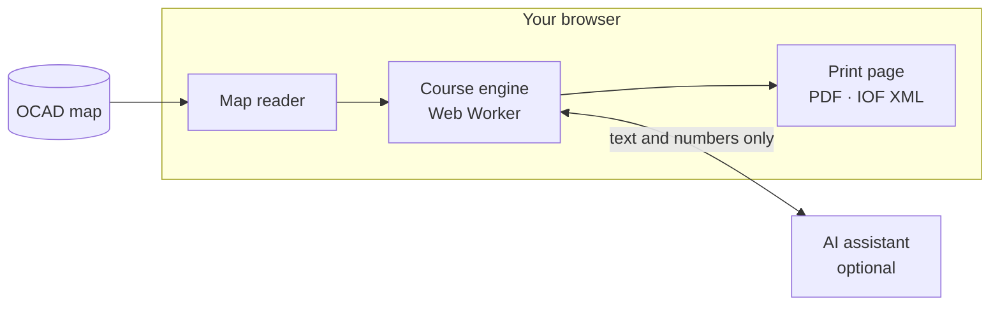

# Ratamestari

**Orienteering courses set automatically from an OCAD map, following IOF rules. Your map never leaves your browser.**

[](https://github.com/pouju/ratamestari/actions/workflows/ci.yml)
[](https://github.com/pouju/ratamestari/releases)
[](LICENSE)
[](https://pouju.github.io/ratamestari/)

Open an OCAD map, choose the class and distance, and Ratamestari sets a course that follows the IOF and Finnish Orienteering Federation (SSL) course-setting rules. You get it on the print page with IOF control descriptions, ready to print or export to OCAD, Condes or Purple Pen. An optional AI assistant lets you ask for changes in plain language.

**[Try it in your browser →](https://pouju.github.io/ratamestari/)**

## What it does

- **Reads OCAD maps** (`.ocd`) and understands them through their ISOM symbols: what is runnable, what is forbidden, what makes a good control site.
- **Sets the course** with a deterministic engine: candidate control sites, a runnability cost map, route finding between controls, and a course search that weighs route choice, rhythm and shape against the target winning time.
- **Checks the rules** (control spacing, course length, forbidden areas, crossing legs…) and cites the IOF or SSL rule behind every finding, with Fix buttons.
- **Writes IOF control descriptions** from the map objects at each control.
- **Fits the course to paper** (A4 or A3, with scale and print area chosen for you) and leaves room for the description box.
- **Lets you edit:** drag controls and the rules are checked again at once.
- **Exports** a print PDF and IOF XML 3.0.

## Your map stays on your computer

Club maps are not public, so Ratamestari never uploads them. The map is read, rendered and processed entirely in your browser. The AI assistant is off by default; when you turn it on with your own API key, it receives only text and numbers, never the map file or any coordinates.



The source code is open so anyone can check this.

## How it is built

A static web app with no backend: TypeScript, React, Vite and OpenLayers, with the course engine in a Web Worker. The rule values (control spacing, winning times, course lengths) live in [`packages/rules`](packages/rules) and each one cites its source document. The reasoning behind the design is in the [decision log](docs/decisions.md).

| Package                                  | Role                                                    |
| ---------------------------------------- | ------------------------------------------------------- |
| [`packages/core`](packages/core)         | Shared types, units and coordinate frames               |
| [`packages/map-ocad`](packages/map-ocad) | Reads OCAD files into the internal map format           |
| [`packages/rules`](packages/rules)       | ISOM symbols, runnability and course rules from IOF/SSL |
| [`packages/engine`](packages/engine)     | Cost map, routing, course search and rule checks        |
| [`packages/iof`](packages/iof)           | Control descriptions and IOF XML                        |
| [`packages/print`](packages/print)       | The print page                                          |
| [`packages/agent`](packages/agent)       | The optional AI assistant and its tools                 |
| [`apps/web`](apps/web)                   | The landing page and the app                            |

## Development

Requires Node 24+ and pnpm.

```sh
pnpm install
pnpm dev        # http://localhost:5173
pnpm check      # formatting, types, tests and build; run before every commit
```

Put test maps in `maps/`. It is git-ignored, so club maps never end up in the repository.

Commit messages follow [Conventional Commits](https://www.conventionalcommits.org/) with the package as scope, for example `feat(engine): …` or `fix(web): …`. Releases are built from them, so a change users will notice should be a `feat` or a `fix`.

## Releasing

Pushes to `main` do not change the live site. [release-please](https://github.com/googleapis/release-please) keeps a Release PR open that bumps the version and updates [`CHANGELOG.md`](CHANGELOG.md) from the commit messages. **Merging the Release PR is the release:** it tags `vX.Y.Z`, publishes a GitHub Release with the notes and deploys that version to GitHub Pages.

To redeploy a release, run the **Deploy** workflow from the Actions tab with its tag.

## Credits

- OCAD files are read with [ocad2geojson](https://github.com/perliedman/ocad2geojson) by Per Liedman.
- Rules from the [International Orienteering Federation](https://orienteering.sport/) and [Suomen Suunnistusliitto](https://www.suunnistusliitto.fi/).

## License

[AGPL-3.0-or-later](LICENSE)
